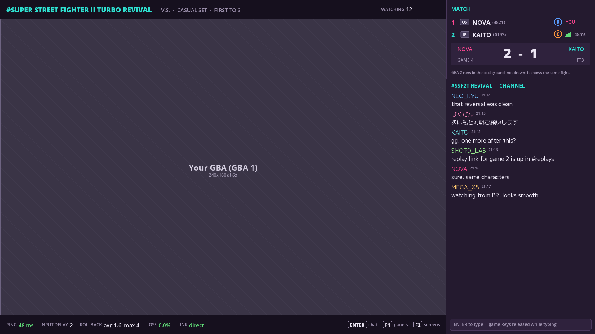
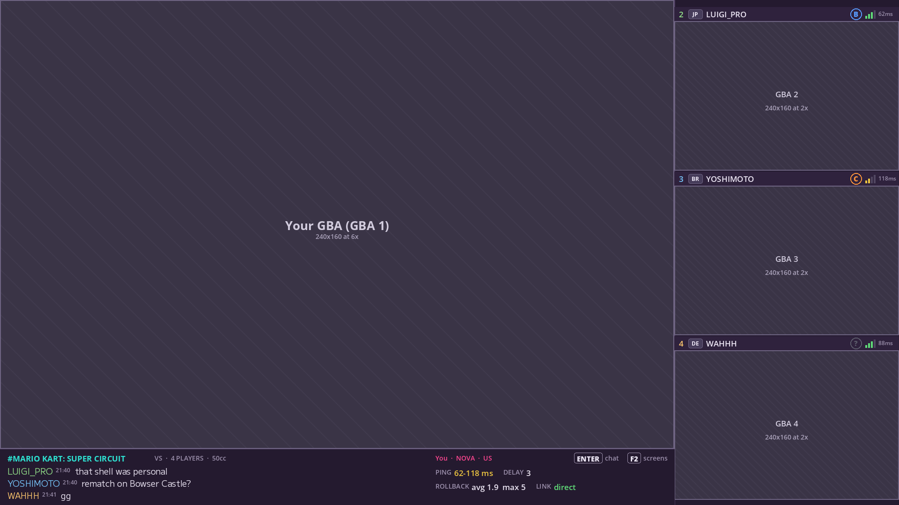
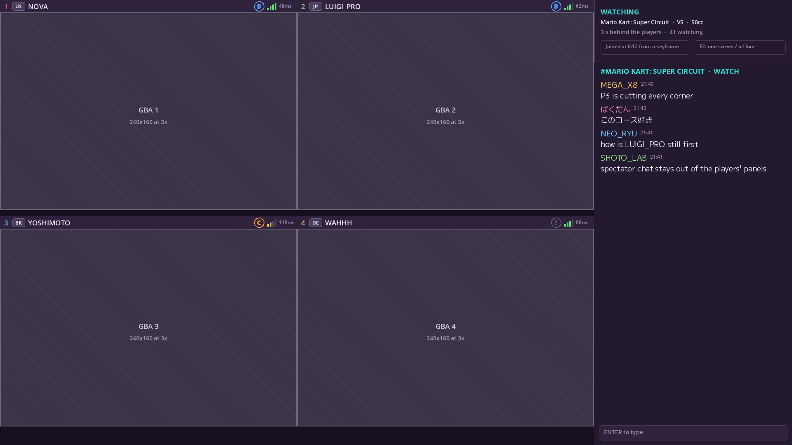

# Netplay client and online service

This document describes how players find each other and play Game Boy Advance and Nintendo DS games online with this fork of mGBA and a fork of melonDS, and the service planned around them. Both forks hide the delay between the players' computers with rollback netcode, which predicts the other players' inputs and corrects the game when they arrive: this fork with the GekkoNet library ([netplay.md](netplay.md) explains it), the melonDS fork with the GGPO library (the melonDS fork's `docs/NETPLAY.md` explains it). The service follows the model of Fightcade, a widely used client for playing emulated arcade and console games online, and runs on Nakama, an open-source game server. Unlike Fightcade, where chat stays in a window separate from the game, mGBA-qt shows the chat and the match information in panels beside the game picture; the melonDS fork keeps the chat in a window of its own, as Fightcade does.

Three programs take part. mGBA-qt has a **netplay window**, which plays a game's netplay profile with every player on one computer, or online. The melonDS fork has an **online window**, with a channel for each game where players chat and challenge each other, and a quick match; the game itself plays in melonDS's main window ([The melonDS fork](#the-melonds-fork)). The **Nakama Matchmaker launcher**, a separate program in its own repository, lists the games, holds a chat room for each, and starts the right emulator when the matchmaker pairs players. mGBA-qt and the launcher use **netplay-online**, a library that they share; the melonDS fork has its own Nakama client and connection code. The server is a Nakama server with the server modules of the IKEMEN GO Nakama fork, which implements online play for the IKEMEN GO fighting-game engine, and the melonDS fork's channel module (`melonds_channel.lua`) for that fork's channels. The clients follow the IKEMEN GO fork's protocol, so one server serves the emulators and IKEMEN GO alike.

## Status

| Part | State |
|---|---|
| GBA netplay core: the link machine, profiles, the GekkoNet session | Built ([netplay.md](netplay.md)) |
| GBA netplay window in mGBA-qt: play on one computer, stress test, online matches | Built ([The netplay window](#the-netplay-window)) |
| netplay-online: Nakama client, direct connections between players, GekkoNet adapter, the launcher's handoff | Built ([Online play](#online-play)) |
| Nakama Matchmaker launcher: game list, rooms with chat, matchmaking, starting the emulators | Built (its repository's README) |
| DS netplay in the melonDS fork: rollback (GGPO) for two players, an online window with game channels, challenges and quick match, matches handed over by the launcher | Built ([The melonDS fork](#the-melonds-fork); its `docs/NETPLAY.md`) |
| Game channels with "looking to play" lists, and challenges | Planned for mGBA and the launcher ([Planned screens](#planned-screens), [Challenges](#challenges)); the melonDS fork has channels of its own ([The melonDS fork](#the-melonds-fork)) |
| Watching and replays | Planned ([Spectating and replays](#spectating-and-replays)) |
| Ranks | Planned ([Ranks](#ranks)) |
| A relay for players whose routers prevent direct connections | Planned ([Connections](#connections)) |

The GBA netplay and the launcher were tested on one Linux computer, with every player on it ([Tests](#tests)); the melonDS fork's `docs/NETPLAY.md` reports that fork's own tests.

## Fightcade's model

Fightcade runs games in bundled emulators and uses GGPO, a rollback netcode library, for online play. It connects players directly, using UDP hole punching so that they need not configure their routers. It records replays. Players supply the ROM files themselves.

Its client is organized around game channels, one per game:

- A **game list** to search, with a card per game showing the number of players in its channel, a mark for games with ranked play, and the platform.
- A **channel** per game, with:
  - a chat with history, mentions and links;
  - a "looking to play" list of the channel's players with country, rank and connection quality;
  - buttons to test the game and to play it offline.

Players challenge each other from the channel, and others can watch their matches.

## The pieces

**Nakama** is an open-source server for online games. It provides accounts, chat (rooms, groups and one-to-one), in-app notifications, a matchmaker, multiplayer matches that it relays or runs with server-side code, storage and leaderboards. Server code (Lua, Go or TypeScript) adds remote procedure calls (RPCs) and match handlers.

**GekkoNet** is this fork's rollback netcode library. It carries the inputs, acknowledgments and checksums between players through an adapter that the program supplies; netplay-online's adapter sends them over the direct connections described under [Online play](#online-play). The melonDS fork uses GGPO, the library that Fightcade uses, with connection code of its own.

**The IKEMEN GO Nakama fork** adds online play to the IKEMEN GO engine on top of Nakama. Its server modules, written in Lua, serve the emulators unchanged. The emulators use two of them so far:

| Server module | What it does | Use by the emulators |
|---|---|---|
| `ikemen_account.lua` | Online names of 2 to 16 characters, shown with a 4-digit tag taken from the account ID to tell equal names apart | Not used: the clients set their Nakama usernames themselves ([Accounts](#accounts)) |
| `ikemen_matchmaker.lua` | Quick and ranked two-player matchmaking on Nakama's matchmaker, with an Elo window from the stored ratings | Its matchmaker hook creates the two-player matches |
| `ikemen_session.lua` | A server-run match for two matched players: messages that set up the direct connection, rematch decisions, replay stream | Carries the two-player matches. Extending it for challenges, 3 and 4 players and spectators is planned. |
| `ikemen_lobby.lua` | Rooms of up to 8 members who play one-on-one matches in turn, with room codes, chat, each member's connection type and round trips, and spectators: it relays the match's input stream and keeps it for those who arrive late | Not used; the model for channels and private rooms |
| `ikemen_rating.lua` | Elo ratings per game, changed once per ranked set (see [Ranks](#ranks)) when both players' claims of its winner agree or a moderator settles it | Not used; planned for ranks |

The melonDS fork's game channels need a server module of its own, `melonds_channel.lua`; its other matches need no module ([The melonDS fork](#the-melonds-fork)).

The IKEMEN GO fork's client code is Go inside the engine, about 6,600 lines. netplay-online ports the parts that matches need to C++ and Qt:

| Fork client part (Go files) | What it does in the fork | In netplay-online |
|---|---|---|
| Nakama client (`src/nakama_client.go`, `src/nakama_account.go`) | Sign-in with a device ID over REST, the realtime WebSocket connection, RPCs, matchmaker tickets, match messages, chat | `NakamaClient`, with `WebSocket`, a small WebSocket client on Qt's TCP and TLS sockets |
| Direct connection (`src/nakama_p2p.go`) | Exchanges address candidates through the Nakama match, finds the public address with STUN, and punches through NATs (the address translation in home routers). IPv4 only, without a relay, with one other player. | `PeerLinks`, which connects every player of a match to every other player on one UDP socket |
| Channels on the socket (`src/nakama_p2pmux.go`) | The first byte of each datagram selects the handshake, control messages (keepalives, pings that measure the players' round trip), a reliable stream (KCP, a reliable transport over UDP) or the rollback packets | `PeerLinks`, with the same byte tags; the reliable stream is not ported |
| Lobby client (`src/nakama_lobby.go`, `src/nakama_watch.go`) | Lobby state, events and commands; reports of connection quality | Not ported |
| Connection type (`src/nakama_netkind*.go`) | Wired, Wi-Fi or mobile, read from the operating system | Not ported |
| Replay stream and replays (`src/replay_stream.go`, `src/replay_live.go`, `src/replay_match.go`, `src/replay_local.go`) | Sends confirmed inputs through the Nakama match after a delay (10 seconds by default), plays received streams, and saves matches as files | Not ported |

Around those parts, netplay-online adds `MatchSession`, which takes one match from sign-in, or from the launcher's handoff, to open connections and carries the match's chat; `GekkoAdapter`, GekkoNet's network adapter on `PeerLinks`; and `ConnectInfo`, the file in which the launcher hands a match to an emulator. Traffic between two emulator clients need not match IKEMEN GO's, since the two never play each other; the signals, the handshake and the datagram tags follow the fork's anyway, with GekkoNet's packets in place of the fork's rollback packets.

Each emulator supplies its **netplay core**: a deterministic machine of all players' consoles, and an identity that the players must share. In mGBA, a profile describes one game setup (ROMs, link, player mapping), and its identity is a hash of everything players must share, from the emulator build to every ROM file; [netplay.md](netplay.md) describes them. The melonDS fork has no profiles: a game is a DS ROM, and its *online identity* is a hash of the ROM and of the version of the fork's online protocol.

## Online play

This section describes what mGBA-qt's netplay window, the launcher and mGBA's headless test program do, through netplay-online. The Nakama-Matchmaker repository's `docs/protocol.md` gives the exact messages, and its `docs/server.md` the server's setup. The melonDS fork has its own client code, which meets the launcher's players through the same matchmaker ticket; [The melonDS fork](#the-melonds-fork) describes it.

### Accounts

A player signs in with Nakama's device authentication: a random device ID, kept in the program's settings, creates the account on first use, so the account belongs to the computer. The netplay window and the launcher each keep their own device ID, and thus their own account; a match that the launcher starts runs with the launcher's account.

Usernames are unique on a Nakama server. A client asks for the player's chosen name first. When another account has it, the client asks for the name followed by `#` and four hexadecimal digits taken from the device ID, such as `Ryu#3fa0`, which stay the same at every sign-in; when that is taken too, the server makes up a name.

### Finding a match

A player who looks for a match adds a ticket to Nakama's matchmaker with the game's identity (a profile's for mGBA, a ROM's online identity for the melonDS fork), the emulator (`mgba` or `melonds`), the mode (`unranked`) and the number of players, and a query that requires all four to be equal. Players with different ROM files or emulator builds (for the melonDS fork, online protocol versions) therefore never meet. The netplay window's **Find a match**, the melonDS fork's **Quick match** and the launcher's **Find a match** use the same ticket, so a player in an emulator's window finds a player in the launcher.

When the matchmaker has enough players, the IKEMEN GO fork's matchmaker hook decides the kind of match: for two players, it creates a server-run `ikemen_session` match; for three or four, it leaves them to a match that Nakama relays. Every player receives the matched users in the same order, which numbers the players.

### Connecting

Each player joins the match and sends the others a hello with its name and profile identity; a player whose identity differs ends the match. Through the match, the players then send each other their address candidates: the computer's own addresses, and its public address as a STUN server reports it. Each player sends handshake packets to every candidate of every other player until one gets through both routers (hole punching), all from one UDP socket. After the handshake, every datagram starts with a byte that marks it as a control message (keepalive, ping, goodbye) or a game packet. Pings every second measure the round trip to each player, and a player silent for 8 seconds counts as gone. Connecting fails when some pair of players has not connected after 20 seconds.

### Playing

Once connected, the netplay thread pings the other players for a second and a half and chooses an input delay from the slowest round trip, unless the player or the launcher set one. In the melonDS fork, the host, one of the two players ([The melonDS fork](#the-melonds-fork)), chooses it as soon as it has measured the round trip, unless its player or the launcher set one; with no measurement 2.5 seconds after the two computers have compared their ROMs, it assumes a round trip of 60 ms:

| Emulator | Netcode | Input delay |
|---|---|---|
| mGBA | Rollback (GekkoNet) | Half the round trip plus 8 ms, in whole frames rounded down; 1 to 6 frames |
| melonDS fork | Rollback (GGPO) | Half the round trip, in whole frames rounded to the nearest; 1 to 6 frames; the host's choice applies to both players |

In mGBA, the GekkoNet session starts once it has heard from every player. Every frame needs every player's input, so a match ends when any player leaves, or when GekkoNet hears nothing from a player for 10 seconds. GekkoNet's checksums detect desyncs, which the window reports in the chat.

### Starting from the launcher

When the matchmaker pairs players in the launcher, the launcher writes the match (the server, its session's tokens, the match, the players in order, the game and its identity) to a file that only the user can read, and starts the emulator with the file's path in the `NETPLAY_CONNECT` environment variable. The emulator reads and deletes the file and checks that the game's identity is the one the launcher matched on. mGBA-qt then opens its netplay window on the match; its main window stays hidden, and the program exits when the netplay window closes. For the melonDS fork, the file's game is a DS ROM (its `game.profile` is the ROM's path): melonDS loads that ROM, computes its online identity again, plays the match in its main window, and quits when the session ends, with exit status 0 when a player left the session and 1 when it failed (the melonDS fork's `docs/NETPLAY.md`, section "From a launcher"). The launcher then becomes ready for the next match. The launcher's `docs/launch.md` describes the file.

## The netplay window

mGBA-qt opens the netplay window from **Tools > Netplay...**. It is a window of its own that uses the main window's key mapping and gamepads. (The melonDS fork plays online in its main window instead; see [The melonDS fork](#the-melonds-fork).)

The setup page holds the profile, the player's name (2 to 16 characters), the Nakama server (host, port, TLS) and its server key, and the ways to start:

- **Play on this computer:** every player's console runs here; the keyboard and gamepads play player 1, and the other players give no input.
- **Stress test:** a GekkoNet stress session, which rolls back every frame and compares checksums, to check that a game stays deterministic.
- **Find a match:** signs in and matchmakes as described under [Online play](#online-play).

mGBA-qt keeps these settings in its `qt.ini`, in the `[netplay]` section, with the device ID and the STUN servers (`stun`; `stun.l.google.com:19302` when empty).

The match screen shows the local player's console: the GBA's picture, which is 240×160, or larger for a ROM hack that declares widescreen margins ([widescreen.md](widescreen.md)). The picture is scaled by a whole number, which keeps pixels square and sharp, and smoothly when the window is smaller than the picture. A column beside it holds the panels:

- **Players:** each player's number, name and round trip, with the local player marked.
- **Other screens:** the other consoles' pictures, when shown ([Screen views](#screen-views)).
- **Chat:** the match's chat. It travels as messages in the Nakama match, separately from the game.
- **Connection:** the input delay, how many frames this computer runs ahead of the others, desyncs, the frame number, and the last and the largest rollback in re-simulated frames.
- **Keys:** the window's own key hints.

Keys mapped to the console go to the game first. Of the others, F1 hides the panels, F2 shows or hides the other players' screens, and the chat key opens the chat input: Enter, or T when Enter plays the game, as it does by default for Start. While the chat input is open, the game sees all of that player's keys let go, and the other players play on; Escape returns to the game.

Sound comes from the local player's console at 48 kHz, through Qt Multimedia (a build without it plays no sound). Frames that GekkoNet re-simulates are neither shown nor heard.

A thread of the window (`NetplayRunner`) runs the machine and GekkoNet at the GBA's frame rate (59.73 frames per second) and keeps the latest pictures and sound for the window. mGBA-qt's emulation thread and its display and audio classes, which serve one console, are not used.

## The melonDS fork

The melonDS fork plays DS games online with code of its own, which its `docs/NETPLAY.md` describes in full; this section sums up how it plays and how it meets the launcher's players. As in mGBA, each computer runs both players' consoles as one deterministic machine, linked by an emulated radio, and only the players' inputs (buttons and touches) travel between the computers. GGPO predicts the other player's input and rolls the machine back when the real input differs. Only the local player's console is drawn and heard; the other one runs headless. Every 60 frames, the two computers compare a hash of the whole machine, and a difference (a desync) ends the session. Online play is for two players.

A game is a DS ROM, without a profile. Its online identity ([The pieces](#the-pieces)) stands for what both players need, the same ROM file and the same online protocol, and `melonDS --netplay-identity <ROM>` prints it.

**System > Multiplayer > Play online (rollback)...** opens the **online window**. Once it is connected to a Nakama server, it opens the loaded game's **channel** (there is one per game), which shows who is there, a chat, and who is looking to play. A player challenges another player of the channel, or starts a **Quick match**, which adds the same matchmaker ticket as the launcher's Find a match ([Finding a match](#finding-a-match)), with the ROM's online identity as the game; melonDS players and the launcher's players therefore find each other. The game plays in melonDS's main window, with melonDS's usual controls, and the window's title shows the ping, the input delay and the depth of the last rollback.

The launcher starts the melonDS fork online in two ways (its **Play offline** just opens the ROM in melonDS):

- **Find a match:** the launcher matchmakes and hands the match over through `NETPLAY_CONNECT` ([Starting from the launcher](#starting-from-the-launcher)).
- **Play online:** the launcher writes a *server profile*, a private file that names its server and account, and starts `melonDS --netplay-config <file> --netplay-online <ROM>`. melonDS then signs in as the launcher's player, opens its online window and joins the game's channel.

A pair from a quick match and a pair that the launcher hands over play the same way. Both join the Nakama match: by its id when the IKEMEN GO fork's matchmaker hook created an `ikemen_session` match, or by the matchmaker's token when Nakama relays the match. Each sends the other a hello with its online identity through the match, and a player whose identity differs ends the match. The two then exchange the signals for the direct connection through the match, with the IKEMEN GO fork's handshake, and the first of the matched users hosts the session. Since they use only Nakama's matchmaker, quick match and the launcher's matches work on any Nakama server, with the IKEMEN GO fork's modules or without them; the channels need the fork's channel module, `melonds_channel.lua`.

The melonDS fork has no spectators, replays or relay yet (its `docs/NETPLAY.md`, section "Limits").

## Screen views

Every computer emulates every console in every game. In a linked game, each console takes part in the link: it exchanges data with the others every frame, and the checksums that detect desyncs cover all of them. What differs between games is which pictures a player needs:

| View | When | Example |
|---|---|---|
| Own screen | All consoles show the same scene, so the other pictures add nothing | *Super Street Fighter II Turbo Revival* V.S.: both GBAs show the same fight |
| All screens | Each player sees a different part of the game, and seeing the others adds to the game | *Mario Kart: Super Circuit* VS races; co-op adventures such as *The Legend of Zelda: Four Swords* (not yet tested) |

With "own screen", the other consoles run without drawing their pictures (`GBALinkMachineSetDrawMask()`). With "all screens", the other players' pictures appear in the side column. A GBA profile's `screens` key (`own` or `all`) sets the view a match starts with, and F2 switches it. The melonDS fork always shows only the player's own console ([The melonDS fork](#the-melonds-fork)).

Drawing is the smaller cost: on the test machine, a GBA's picture takes 0.2 to 0.45 ms per frame to draw, and the GBA itself 0.6 to 0.8 ms to emulate ([netplay.md, Results](netplay.md#results)).

Another player's screen can show what the game hides from you, such as items in hand or positions in a battle mode, so a channel's rules could limit "all screens" to spectators in competitive play; the window does not enforce such rules yet.

## Tests

mGBA has a headless player of online matches, `mgba-netplay-online-test` (built with `BUILD_TEST=ON`). It plays one player with scripted keys: it matchmakes for a profile (`--profile`, `--device`, `--name`, `--host`, `--port`, `--key`), or joins the match that a launcher hands it, plays a number of frames (`--frames`) and writes each frame's checksum (`--trace`). `--identity` prints the profile's identity and exits. `tools/netplay/run_online_test.sh` runs several of them against a Nakama server and compares their traces:

```sh
tools/netplay/run_online_test.sh build/mgba-netplay-online-test 127.0.0.1 7350
```

A test server is best, since the test accounts look for matches like any player.

Results, with every player on one 2-core Linux computer (Intel Xeon at 2.80 GHz) and Nakama 3.41.0 on the same computer:

| Test | Players | Frames | Result |
|---|---|---|---|
| `run_online_test.sh`, `linkstress-2p` | 2 | 900 | Identical traces; input delay 1; 0 and 55 rollbacks, the largest re-simulating 7 frames; no desyncs |
| `run_online_test.sh`, `ssf2tr-vs` | 2 | 900 | Identical traces; input delay 1; 0 and 51 rollbacks, the largest re-simulating 7 frames; no desyncs |
| `run_online_test.sh`, `mksc-3p` | 3 | 600 | Identical traces; input delay 1; 0, 0 and 75 rollbacks, the largest re-simulating 7 frames; no desyncs |
| Two or three launchers in `--auto` mode, each starting the headless player | 2 and 3 | 300 to 600 | Identical traces |
| Two launchers starting mGBA-qt | 2 | until left | Both windows in sync; keys, chat, F2 and leaving the match work |

The traces compare every frame except the last 10, which a player may have simulated on predicted inputs before it stopped. Rollback counts, and the scripted keys' timing, vary from run to run; equal traces between the players of a run are what each test checks. Not yet tested: players on different networks behind real NATs, Windows and macOS, and long matches.

The melonDS fork tests its netplay with a tool of its own, `melonDS-netplay-tool`, and reports the results in its `docs/NETPLAY.md` (sections "Games tested" and "Speed"), among them two commercial games, *Mario Kart DS* and *Jump Ultimate Stars*, played through their local wireless multiplayer in sessions with rollbacks.

## Planned screens

The netplay window covers one match. The service around it is planned as follows.

### Game list

The game list shows one card per game that has a profile, with its channel's player count, a ranked mark and the number of players the game takes. The client finds a game's ROM among the player's files by its hash, so file names do not matter, and marks games whose files are missing. ROM files never leave the player's computer.

The counts come from one server RPC that returns the number of members of every channel. Card pictures need a source the service may publish, such as art from the player's own files or licensed art; without one, a card shows the title.

The launcher's game list is the first step: it lists the games of its own settings, with a chat room per game, but no counts, ranks or ROM search.

### Game channel

A channel is a Nakama chat room named after the game. The launcher's rooms are such rooms, named after the emulator and the game's identity (a profile's for mGBA, a ROM's for the melonDS fork). Beside the chat, the planned "looking to play" list shows the channel's members with:

- region;
- online name and tag;
- rank letter;
- state: looking to play, in a match, or away;
- estimated connection quality to the viewer (see [Connections](#connections)).

The channel also lists matches in progress, which anyone can watch, the channel's replays and its rankings. Two buttons start the game locally: alone, or with every player's console in one window for local link play.

Channel states (looking to play, in a match) need more than Nakama's chat presence. A server-run channel match per game holds them and sends changes to the members, on the pattern of the IKEMEN GO fork's lobby match. The melonDS fork's channels already work this way: each one is a server-run match of that fork's channel module, which holds the members' states and carries the channel's chat.

### Match screen

The game picture is scaled by a whole number and never covered, and the panels fill the space that it leaves: for a 240×160 GBA picture in a 1920×1080 window, 6 times (1440×960 pixels), which leaves a 480-pixel column beside it and 120 pixels of height. F1 hides the panels. (The melonDS fork shows a DS game's two screens in its main window, with melonDS's own screen layouts, and keeps the channel and the chat in its online window.) These layout mockups show the plan:



Beyond what the netplay window shows today, the panels add:

- **Players:** region and rank letter.
- **Score:** the score of the set, when the profile can read results (see [Ranks](#ranks)).
- **Connection:** packet loss, and whether the connection is direct or relayed.
- **Spectators:** how many are watching.
- **Chat:** the channel's chat besides the match's; for controller players, a short list of preset messages on a button that the game does not use; and a focus option that holds incoming messages until the set ends.



### Watching

A spectator sees every console's screen, for four GBAs at 3 times scale in a 2×2 grid. One picture is enough when all consoles show the same scene, as in a fighting game. The spectator's chat is the channel's or the match's.



## Challenges

In mGBA and the launcher, today's matches come from the matchmaker, which pairs any players who look for the same game. A **challenge** lets players choose each other in a channel. The melonDS fork's channels have challenges already, in a way of their own: the channel pairs the two players and relays their connection signals (its `docs/NETPLAY.md`, section "Through a server"). For mGBA, the plan is:

1. The challenger picks a player in the channel. A server RPC checks that both are in the channel and free, creates a session match for both, and sends the challenged player an in-app notification.
2. The challenged player accepts, by joining the session, or declines.
3. Each player joins with their profile identity. The server admits only matching identities and states the reason otherwise, for example a different ROM file or emulator version.
4. The clients connect directly, as matchmade players do. The measured round trip suggests an input delay, which both players see.
5. The machine starts from power-on and the GekkoNet session begins. Players use the game's own menus to set up the link game, as on real hardware.
6. Games follow one another in the same session until a player ends it. The set's results go to the rating RPC (see [Ranks](#ranks)).

A **session match** is the server-run Nakama match that holds one online match: its players, its spectators, the messages that set up the direct connections, rematch decisions and the spectator stream. The IKEMEN GO fork's session module provides this for two matchmade players; challenges need it for players who choose each other.

A profile may define a start state to skip boot screens: a state that every peer produces by running the profile's scripted inputs from power-on. Because the machine is deterministic, every peer arrives at the same state. GBA sessions still start from power-on, since a GBA profile's identity leaves the intro out.

**Three and four players** play mGBA today through the matchmaker, over a direct connection between every pair of players (6 pairs for four players) on one socket. A challenge for three or four would open seats in the channel, which other players take; the session starts when every seat is filled.

## Spectating and replays

The host sends all players' confirmed inputs to the session match a few seconds behind the match (10 by default in the fork), two batches per second, as the fork's lobbies do. Inputs are final by then: GekkoNet predicts at most 8 frames ahead, so no input that old can still change. The session match relays them to the spectators and keeps them for those who arrive late.

A spectator who arrives late needs a starting point. The fork's lobbies send late watchers every message from the start of the match, and the spectator replays the match at up to 4 times normal speed until it is close to the players: one arriving 20 minutes into a set catches up after about 7 minutes. With four GBAs, 4 times speed without drawing takes about three quarters of one CPU core of the test machine ([netplay.md, Results](netplay.md#results)). **Keyframes** shorten this: compressed machine states, for example one every 30 seconds, from which a spectator catches up in seconds.

| Machine | State | Compressed (zlib, level 6) |
|---|---|---|
| 2 GBAs (*Super Street Fighter II Turbo Revival* V.S.) | 1,056,920 bytes | 119,142 bytes |
| 3 GBAs (*Mario Kart: Super Circuit* race) | 1,585,308 bytes | 152,843 bytes |
| 4 GBAs (*Mario Kart: Super Circuit* race) | 2,113,696 bytes | 206,394 bytes |

The session match holds the latest keyframe in pieces under Nakama's message size limit (64 KB in the fork's required server settings). A keyframe loads only on the same emulator build, which the profile identity guarantees. DS machine states are much larger (a DS has 4 MB of main memory alone, a GBA 288 KiB of work RAM), so DS spectators, which the melonDS fork does not have yet, would replay from the start or need another kind of keyframe.

GekkoNet has spectator sessions of its own, in which a spectator connects to a player directly and can join late from a state that the player sends. That state goes out uncompressed in 900-byte packets and is sent again in full until the spectator acknowledges it: about 1,200 packets for two GBAs and 2,350 for four, from the player's connection, during the match. Spectating through the server avoids that load and needs no direct connection to each spectator.

A **replay** is a profile identity, a start (power-on or the profile's start state) and the inputs: 2 bytes per player per frame for the GBA, about 0.4 MB per player per hour before compression. GekkoNet records the confirmed inputs of a session, optionally with checksums, and plays recordings back in its replay sessions, which report the first frame whose checksum differs. The client saves replays locally and can upload them to Nakama storage for the channel's replay list. Keyframes inside a replay allow seeking.

## Ranks

A rank needs results that both sides accept. A profile can define **result detectors**: conditions on the machine's memory that mark the end of a game and its winner, such as a fighter's health reaching zero or a race's finishing order.

Every peer's machine is identical, so every client computes the same result and submits it. The IKEMEN GO fork's rating RPC rates a *ranked set*: a best-of-N series of matches between the two players of a ranked session, the session match that the fork's matchmaker hook creates for two players who asked for a ranked match. It changes the ratings once per set, when both players' claims of the winner agree, and leaves claims that disagree to the server's moderators (the fork's `nakama/README.md`, section "Ranked sets"). It takes no claims for other matches, so ranks for the emulators would need ranked sessions of their own. Without a detector, players would have to claim results themselves, so matches without one stay unranked; today's matchmaking uses the `unranked` mode for that reason.

Ratings are Elo per game, as in the fork (starting at 1,000, K factor 32). Channels display them as letter bands.

## Connections

The direct connections work when both players are behind typical home routers, or one has a public address. Following the fork's notes (`nakama/README.md` in the fork), they fail between a symmetric NAT and a port-restricted NAT, and between two connection-tracking NATs without a WAN firewall. A service needs a relay for those players, such as a TURN server (the standard relay for such connections).

Relaying game packets through a Nakama match would not work as is: the fork's matches run at 10 ticks per second, so they batch messages by up to 100 ms.

The channel list needs a connection estimate before two players have connected. Possible approaches:

- **Region plus each player's round trip to the server:** coarse. The fork's lobbies show this until two players have played each other.
- **Network coordinates:** each client measures its round trip to a few reference servers and derives a position, so that the distance between two players' positions approximates their round trip (as in the Vivaldi algorithm).
- **A real ping test** between two players when a challenge opens: exact, and it sets the suggested input delay. mGBA-qt's netplay window and the melonDS fork measure this over the direct connection once it is open.

## Where the code lives

| Part | Where |
|---|---|
| GBA machine, profiles, GekkoNet session | This fork's core library: `src/gba/sio/linkmachine.c`, `src/feature/netplay/` |
| GBA netplay window and headless online player | This fork's Qt frontend: `src/platform/qt/netplay/` |
| DS machine, GGPO session, direct connection | The melonDS fork: `src/net/rollback/` |
| DS online window, Nakama client, what the launcher hands over | The melonDS fork's Qt frontend: `src/frontend/qt_sdl/` (`NetplayOnlineDialog.*`, `NakamaClient.*`, `NetplayLauncher.*`) |
| netplay-online | The Nakama-Matchmaker repository (`netplay-online/`); a copy in `src/third-party/netplay-online/` here |
| Launcher | The Nakama-Matchmaker repository (`launcher/`) |
| Server modules | The IKEMEN GO Nakama fork's `nakama/modules/`, unchanged |
| DS channel module | The melonDS fork: `src/net/rollback/server/melonds_channel.lua`; a copy in the Nakama-Matchmaker repository's `server/modules/melonds/` |

netplay-online is under the MIT license, as is the IKEMEN GO fork whose protocol it follows. mGBA is under the Mozilla Public License 2.0, and an MIT library fits it; this fork carries a copy, as it does GekkoNet. netplay-online needs Qt 5 or 6 with its Network module, which mGBA-qt uses already; its WebSocket client avoids a dependency on the Qt WebSockets module. The melonDS fork, under the GNU GPL version 3, does not use netplay-online; its channel module, which contains no melonDS code, is under the MIT license.

## Next steps

1. **Channels:** a game list with counts, channel chat with the looking-to-play list, challenges, and seats for 3 and 4 players.
2. **Watching:** the spectator stream with keyframes, and replays with upload and listing.
3. **Ranks and reach:** result detectors, ratings and letter bands, a relay, and connection estimates in the channel list.

## Open problems

- **Connectivity:** without a relay, some pairs of players cannot connect.
- **Cost of four consoles:** each computer runs every console, which leaves room for about 3 re-simulated frames per frame in a four-GBA race on the test machine ([netplay.md, Results](netplay.md#results)). Running consoles on separate CPU cores is not implemented in this fork (the melonDS fork does it). A DS, with two CPUs at 67 and 33 MHz and a 3D engine, is much heavier to emulate than a GBA, with one CPU at 16.8 MHz: in the melonDS fork, which runs a session's consoles without its JIT recompiler, two DS consoles take 8 to 12.5 ms of each 16.7 ms frame on a 2-core machine, and a frame with a rollback of one frame 16 to 25 ms (the melonDS fork's `docs/NETPLAY.md`, section "Speed").
- **Hosting:** a public service needs a Nakama server with its database, moderation (mutes, reports, bans) and someone to run them.
- **Fairness:** whether players may watch each other's screens depends on the game and the competition (see [Screen views](#screen-views)).
- **ROMs and art:** players must supply their own ROMs. The clients identify them by hash and never send them anywhere. Game art for the game list needs a publishable source.

## Sources

- Fightcade, Wikipedia: https://en.wikipedia.org/wiki/Fightcade
- Nakama concepts: https://heroiclabs.com/docs/nakama/concepts/
- IKEMEN GO Nakama fork (source and `nakama/README.md`): https://github.com/RollinJay/IkemenGo-Nakama
- Nakama Matchmaker and netplay-online (`docs/protocol.md`, `docs/launch.md`, `docs/server.md`): https://github.com/RollinJay/Nakama-Matchmaker
- melonDS netplay fork (`docs/NETPLAY.md`): https://github.com/RollinJay/melonDS-test
- GGPO: https://github.com/pond3r/ggpo
- GekkoNet: https://github.com/HeatXD/GekkoNet
- KCP, a reliable transport over UDP: https://github.com/skywind3000/kcp
- Vivaldi network coordinates (Dabek et al., "Vivaldi: A Decentralized Network Coordinate System", SIGCOMM 2004): https://dl.acm.org/doi/10.1145/1015467.1015471
